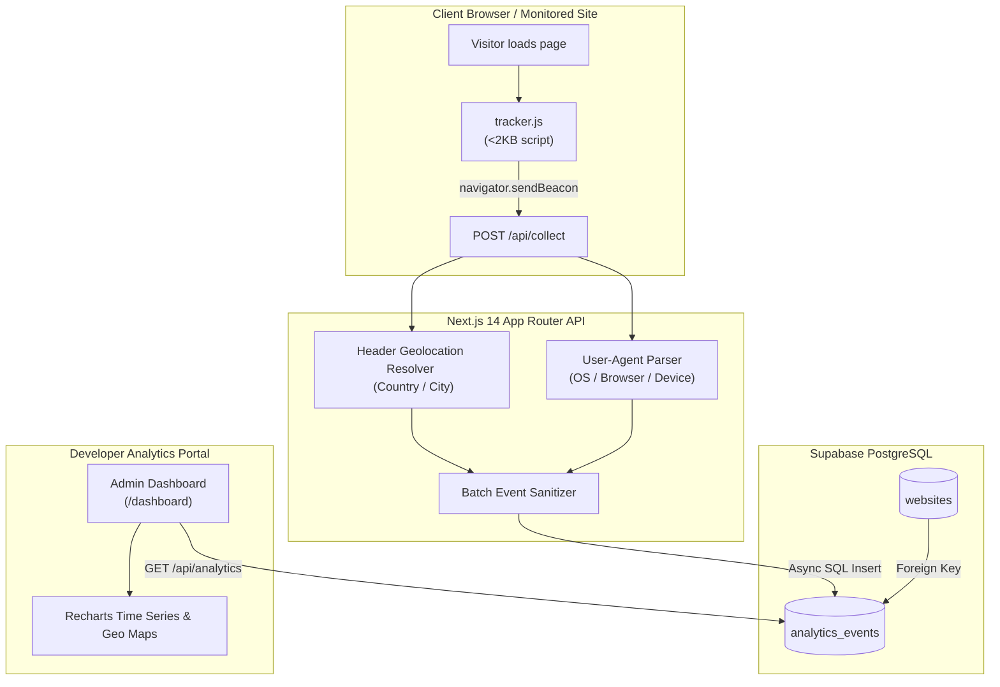

# 📊 Pulse Analytics (Devactics) — Privacy-First Web Telemetry

[](https://nextjs.org/)
[](https://react.dev/)
[](https://www.typescriptlang.org/)
[](https://tailwindcss.com/)
[](https://supabase.com/)
[](LICENSE)

> **Lightweight, privacy-first developer analytics platform featuring approximate IP geolocation, zero-cookie telemetry pings, Supabase PostgreSQL persistence, and interactive real-time dashboards.**

---

## 🌟 Why Pulse Analytics?

Traditional analytics suites (like Google Analytics) are bloated, introduce heavy client script bundles (>45KB), rely on persistent tracking cookies, and present complex compliance issues under GDPR, CCPA, and PECR.

**Pulse Analytics** was engineered as an open-source, developer-friendly alternative:
- 🪶 **Sub-2KB Tracking Script (`public/tracker.js`)**: Zero external dependencies, asynchronous, non-blocking via `navigator.sendBeacon` with `fetch` fallback.
- 🛡️ **Cookie-Free & Privacy Conscious**: No cookies, no localStorage fingerprinting, and **no raw IP addresses are ever stored** in your database.
- 🌍 **Edge Geolocation**: Dynamically extracts country and city from edge server request headers (`x-forwarded-for`, Cloudflare `cf-ipcountry`, Vercel `x-vercel-ip-country`).
- 📱 **Device & Browser Intelligence**: Parses User-Agent strings server-side using `ua-parser-js` into structured OS, Browser, and Device categories.
- 🧪 **Built-in Testing Playground (`/test-site`)**: Includes an interactive in-app demo site so you can test tracking beacons and verify ingestion without deploying an external site.
- 📈 **Modern Recharts Visualizations**: Instant insight into total pageviews, unique visitors, referral sources, geographical distribution, and bounce rates.

---

## 🏗️ System Architecture



---

## 🔌 1-Line Embed Code

Add this lightweight tracking snippet into the `<head>` or `<body>` tag of any HTML or React/Next.js website:

```html
<script 
  defer 
  src="https://your-analytics-domain.com/tracker.js" 
  data-website-id="YOUR_WEBSITE_UUID">
</script>
```

### How It Operates:
1. Listens for initial page load and SPA route changes (`pushState` / `popstate`).
2. Fires a single non-blocking HTTP POST beacon containing:
   - `pathname` (current URL path)
   - `referrer` (traffic source origin)
   - `website_id` (your unique registered UUID)
3. The server extracts location and device metadata without tracking individual identity across websites.

---

## 🗄️ Supabase PostgreSQL Schema (v2)

Run this SQL query inside your **Supabase Dashboard → SQL Editor**:

```sql
-- 1. Create Websites Table
CREATE TABLE IF NOT EXISTS public.websites (
    id UUID PRIMARY KEY DEFAULT gen_random_uuid(),
    user_id UUID REFERENCES auth.users(id) ON DELETE CASCADE NOT NULL,
    name TEXT NOT NULL,
    domain TEXT NOT NULL,
    created_at TIMESTAMP WITH TIME ZONE DEFAULT timezone('utc'::text, now()) NOT NULL
);

-- 2. Create Analytics Events Table
CREATE TABLE IF NOT EXISTS public.analytics_events (
    id UUID PRIMARY KEY DEFAULT gen_random_uuid(),
    website_id UUID REFERENCES public.websites(id) ON DELETE CASCADE NOT NULL,
    pathname TEXT NOT NULL,
    referrer TEXT,
    browser TEXT,
    os TEXT,
    device TEXT,
    country TEXT,
    city TEXT,
    created_at TIMESTAMP WITH TIME ZONE DEFAULT timezone('utc'::text, now()) NOT NULL
);

-- 3. High Performance Indexes
CREATE INDEX IF NOT EXISTS idx_events_website_created ON public.analytics_events(website_id, created_at DESC);
CREATE INDEX IF NOT EXISTS idx_events_pathname ON public.analytics_events(website_id, pathname);
CREATE INDEX IF NOT EXISTS idx_events_country ON public.analytics_events(website_id, country);

-- 4. Enable Row Level Security (RLS)
ALTER TABLE public.websites ENABLE ROW LEVEL SECURITY;
ALTER TABLE public.analytics_events ENABLE ROW LEVEL SECURITY;

CREATE POLICY "Users can manage their own websites" 
  ON public.websites FOR ALL 
  USING (auth.uid() = user_id);

CREATE POLICY "Anyone can insert analytics events" 
  ON public.analytics_events FOR INSERT 
  WITH CHECK (true);

CREATE POLICY "Users can view analytics for their websites" 
  ON public.analytics_events FOR SELECT 
  USING (
    website_id IN (
      SELECT id FROM public.websites WHERE user_id = auth.uid()
    )
  );
```

---

## 📡 REST API Reference

| Method | Endpoint | Description | Auth Required |
| :--- | :--- | :--- | :---: |
| `POST` | `/api/collect` | Ingestion endpoint receiving beacon pings from `tracker.js` | ❌ No |
| `GET` | `/api/analytics` | Aggregates views, unique visitors, top paths, referrers, and geo data | ✅ Yes (Session) |
| `GET` | `/api/websites` | Returns list of registered websites under authenticated user | ✅ Yes (Session) |
| `POST` | `/api/websites` | Registers a new website domain and returns unique tracking ID | ✅ Yes (Session) |
| `POST` | `/api/auth/signup` | Creates a new developer account via Supabase Auth | ❌ No |
| `POST` | `/api/auth/login` | Authenticates developer session | ❌ No |
| `POST` | `/api/auth/signout` | Terminates active session | ✅ Yes (Session) |

---

## 🚀 Quick Start & Installation

### 1. Prerequisites
- **Node.js** >= 18.x
- **npm** or **pnpm**
- A **Supabase** account (Free tier supported)

### 2. Clone & Install
```bash
git clone https://github.com/akshadit/analytics.git
cd analytics
npm install
```

### 3. Configure Environment Variables
Create a `.env.local` file in the root directory:
```env
NEXT_PUBLIC_SUPABASE_URL=https://your-project.supabase.co
NEXT_PUBLIC_SUPABASE_ANON_KEY=your-supabase-anon-key
SUPABASE_SERVICE_ROLE_KEY=your-supabase-service-role-key
```

### 4. Run Development Server
```bash
npm run dev
```
Open [http://localhost:3000](http://localhost:3000) to view the portal.
Visit [http://localhost:3000/test-site](http://localhost:3000/test-site) to trigger live test telemetry!

---

## 🚢 Deployment

### Deploy to Render (`render.yaml`)
This repo includes a preconfigured `render.yaml` for 1-click deployment on Render:
1. Connect your GitHub repository in the **Render Dashboard**.
2. Select **Blueprint** deployment.
3. Supply `NEXT_PUBLIC_SUPABASE_URL`, `NEXT_PUBLIC_SUPABASE_ANON_KEY`, and `SUPABASE_SERVICE_ROLE_KEY`.

### Deploy to Vercel
Push to GitHub and import directly into Vercel. Add the three Supabase environment variables in the project settings.

---

## 📄 License

Distributed under the [MIT License](LICENSE).
